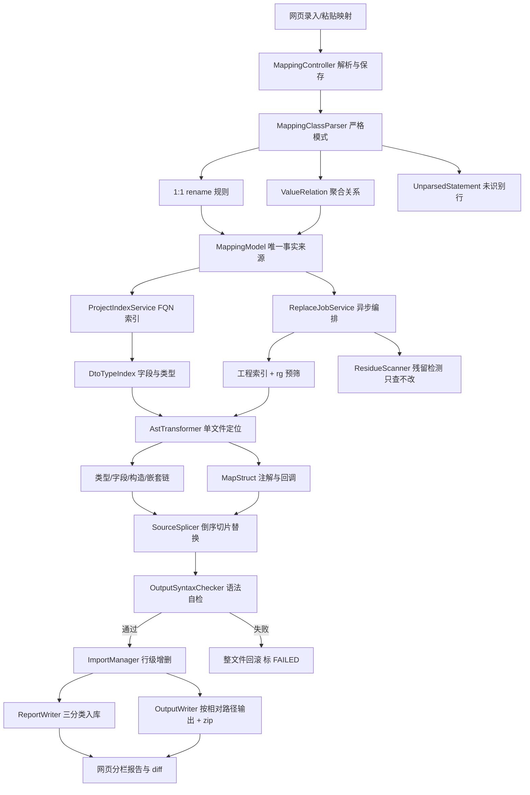

## 用户需求

对超大型 Maven 多模块 Spring Batch 工程（10 万+ Java 文件、单文件约 3000 行、200 个 DTO 映射方法）批量把旧 DTO（如 ADto）系统性替换为新 DTO（如 BDto），字段按映射关系对应转换。以网页工作台操作，绝不修改源代码，只输出被改写的 Java 文件（保持相对路径），并给出「替换成功 / 需人工审核 / 失败」三分类报告。映射关系由用户在网页上填写维护，无需在工程内添加映射类。

## 产品概述

部署在企业内网服务器的 DTO 批量重构工作台。用户先在网页上录入或粘贴 DTO 映射，再选择源码路径启动异步任务；系统只读源码、精确改写、按相对路径输出改动文件供下载，并在网页分栏呈现三类结果与审核清单。全过程源文件保持原样不动。

## 核心功能

- **映射录入与管理**：命名保存映射配置；结构化表单与粘贴 Java 转换方法两种录入方式产出同一份映射；支持一次粘贴多个转换方法批量解析；解析结果可预览，聚合关系可在页面上人工裁决，无法识别的语句以「未识别行」清单交人工补录。
- **精确改写**：覆盖类型引用与 import、泛型、方法签名、字段读写、构造与工厂调用、作用域内嵌套 DTO 链；只替换类型，不改变量名。
- **聚合表达式支持**：源侧多字段合并到目标单字段（如 `目标.setX(源.getY()+源.getZ())`）时，各字段独立改写、表达式结构不动；无法确认合并语义的语句单独标注人工审核，绝不猜测。
- **MapStruct 处理**：改写注解内的属性名与表达式参数，处理初始化方法与回调方法；不处理生成代码。
- **输出保真**：未改动区域与原文件完全一致，不产生格式噪音；含待审项的文件按「已确定处照改、未决处原样保留」部分改写，并单独标注为不可直接编译。
- **三分类报告**：成功、需人工审核（附风险与建议）、失败（附原因）；提供文件级差异对照、审核清单与报告下载。
- **只输出改动文件**：按原相对路径输出并打包下载，输出与源码物理隔离；提供「残留检测」用于收尾确认是否仍有旧类型引用。
- **高性能异步**：预筛 + 局部作用域精改 + 并行分块，进度实时反馈，任务临时目录隔离并自动清理。

## 范围边界

- 不修改源码；不做编译验证，由用户在本地工程自行执行；不做登录鉴权（内网部署，仅保留路径白名单与上传安全校验）。
- 注释与普通日志/JSON/反射字符串不处理，字符串仅处理 MapStruct 注解内部；对其他可能失效的字符串引用只做检测与提示。
- 生成源码、二进制资源、第三方依赖、pom 等配置本轮不处理。
- DTO 类定义文件本身不改写，只替换使用点。
- 需人工审核的条目一律原样输出。

## 一、技术栈选型（沿用原基线，工程为空目录从零搭建）

工程位置 `c:/Users/18691/CodeBuddy/dtoreplace` 已确认为 0 文件，无既有代码模式可参照，按通用成熟选型搭建：

- **后端**：Spring Boot 3.3.x + Java 17，Maven 构建；REST API + `ThreadPoolTaskExecutor` 异步任务 + SSE 进度推送；打包为内嵌前端静态资源的可执行 JAR，内网单包部署。
- **前端**：React 18 + TypeScript + Vite 5 + Tailwind CSS 3.4.17 + shadcn/ui，构建映射、配置、监控、报告、下载五类页面。
- **AST 引擎**：JavaParser 3.26.x，**不启用 JavaSymbolSolver**，采用文件内局部作用域分析；仅在边界情况按需符号求解。AST **仅用于定位**，不使用 `toString()` 打印（会重排格式），不使用 `LexicalPreservingPrinter`（千行级文件已知性能退化，javaparser issue #4551）。
- **文本预筛**：ripgrep 高速扫描旧 DTO 简单类名；**rg 不可用时自动降级**为内置 Java NIO + Aho-Corasick 扫描（内网服务器常不允许放外部二进制）。
- **存储**：嵌入式 SQLite（`sqlite-jdbc` + WAL + 单写线程批量提交），表 `replace_job / job_log / job_checkpoint / mapping_config / type_mapping / field_mapping / value_relation / change_record / file_summary / project_index_cache`；报告另导出 Excel/CSV（Apache POI）。
- **构建**：父 POM 聚合 backend；前端 `npm ci && npm run build` 产物拷入 `backend/src/main/resources/static`。

## 二、实现总体策略

「文本预筛 → 单文件定位 → 源文本切片替换 → 三分类报告 → 只输出改动文件」双阶段。用户录入与粘贴解析统一产出 `MappingModel` 作为唯一事实来源；源码只读，结果写入独立输出区，天然免回滚。

**六项已拍板决策固化到设计**：

| 决策 | 落地方式 |
| --- | --- |
| 输出保真 = 源文本切片替换 | 新增 `SourceSplicer`，AST 只产出 `TextEdit(offset, endOffset, replacement)`，写盘时倒序应用，未触达区域字节级不变 |
| 含待审项的文件部分改写 | 文件级 `hasUnresolved` 标记，产物分「可直接应用」与「需人工处理」两栏 |
| 默认不重命名变量 | 删除 `VariableRenamer`，`LocalScopeAnalyzer` 只做类型判定不做重命名绑定 |
| 映射仅靠粘贴解析 + 表单 | `MappingClassParser` 为唯一数据来源，列为全系统单点故障，必须先做原型验证（里程碑 0） |
| 不做编译验证 | 验收改由「输出语法自检 + 抽样人工确认 + 残留检测」承担 |
| 不做鉴权 | 路径白名单默认拒绝，README 显式记录风险 |


## 三、输出保真与写盘策略（新增章节）

**核心问题**：JavaParser 普通 `toString()` 会重排注解/换行/缩进，3000 行文件 diff 噪音巨大；LPP 大文件性能退化。方案：**AST 定位 + 原文切片替换**。

- **编辑模型**：`TextEdit{offset, endOffset, replacement, ruleType}`，offset 为**原文字符偏移**；行级操作单独用 `INSERT_LINE / DELETE_LINE` 类型，避免与行内编辑互相干扰。
- **倒序应用**：类型名长度不同（如 `UserDtoReq` → `UserDTO`）会导致后续点位偏移，编辑必须按 offset **从大到小**应用，保证偏移不失效。
- **冲突检测**：同一区间被多条规则命中时保留首条，冲突项标 `NEED_REVIEW` 并记录冲突依据。
- **import 处理**：删除是整行移除、添加是整行插入，**不重排 import 顺序**（重排会改动未触碰行制造 diff 噪音）；新 import 追加到 import 区块末尾，无 import 区块时插入到 package 声明之后。
- **语法自检**：写盘前用 JavaParser 重新解析自身输出做**语法级校验**（不引入 Maven 依赖，属轻量自检，非编译验证）；不通过则整文件回滚并标 `FAILED`，不产出损坏文件。
- **diff 体积上限**：单文件改动行数超过阈值（默认 200 行）时告警并单独标注，提示人工重点审阅。

## 四、类型判定与降级阶梯（新增章节）

无 SymbolSolver 时类型只能语法推导，必须显式定义降级阶梯，否则实现者各写各的：

| 层级 | 判定依据 | 行为 | 分类 |
| --- | --- | --- | --- |
| **L0 文件内可判定** | 本文件内的变量声明、方法参数、字段声明、直接 `new` 构造 | 精确替换 | SUCCESS |
| **L1 DTO 类型索引命中** | 索引中能查到该类型的 getter 返回类型 / setter 参数类型 | 精确替换 | SUCCESS |
| **L2 需跨文件** | 类型来自方法返回值、父类继承、泛型集合、多态、lambda 参数 | 原样不改 + 记录推断缺口 | NEED_REVIEW |
| **L3 语义存疑** | 同名不同包、反射字符串、record 组件访问（`p.x()` 非 getter）、外部 jar 类型 | 原样不改 + 记录风险 | NEED_REVIEW / FAILED |


**DTO 类型索引按 FQN 建键**（原计划按类名建键是错的：多模块同名 DTO 会误判）。索引结构：FQN → 源文件路径（工程索引阶段一次全工程扫描建立并落库，按源根 hash 失效复用）+ FQN → 成员索引（字段名、显式 getter 返回类型、显式 setter 参数类型）。**Lombok 隐式成员**：显式方法优先，缺失时按字段名推导 getter/setter（`getX/setX/isX`）。

## 五、粘贴解析规格（新增章节，严格模式绝不猜测）

粘贴解析是 Q4 决策下的**唯一数据来源**，是全系统单点故障。

**两类关系必须分离建模**：

- **属性重命名对应（rename mapping）**：一对一，源类型字段 → 目标类型字段，是引擎批量替换的**唯一依据**。
- **值计算关系（value relation）**：n:1 / n:m 的字段合并，**不生成 rename 映射**，只驱动人工裁决与审核告警。

若把 `setX(getY()+getZ()+getA())` 强行记成 3 条 `(Y→X)(Z→X)(A→X)`，会误伤工程别处单独出现的 `a.getUserName()`（被错误改成 `getNickname()`），并可能生成错误的 `@Mapping(source="Y", target="X")`——因为新 DTO 中根本没有 Y 的对应物（Y 已合并进 X）。

**解析器分类规则**：

| 表达式形态 | 解析关系 | 自动入 1:1 表 | 引擎行为 | 分类 |
| --- | --- | --- | --- | --- |
| `b.setX(a.getY())` | 1:1 | 是（标待复核） | `getY()`→`getY'()`，`setX` 不动 | SUCCESS |
| `b.setX(a.getY().getZ())` | 嵌套路径 1:1 | 是 | 逐段替换 | SUCCESS |
| `b.setX(a.getY()+a.getZ()+a.getA())` | n:1 聚合 | **否** | 各 get 若各有 1:1 规则则逐个改名；缺规则则整句不动 | NEED_REVIEW（缺规则时） |
| `b.setX(cond?a.getY():a.getZ())` | 复杂 | 否 | 整句不动 | NEED_REVIEW |
| `b.setX(a.getY()+"lit")` | 复杂 | 否 | 整句不动 | NEED_REVIEW |
| 无法配对的语句 | — | 否 | — | 列入「未识别行」，前端手工补录 |


**聚合关系人工裁决**（依据来自 DTO 类型索引的字段候选提示，非新增录入方式，决定权在用户）：

- **结局 A**：新 DTO 中确有对应属性（如 `ADto.userName` 在 `BDto` 中叫 `nickname`）→ 实为 1:1，确认后**升格为 1:1 规则**，引擎照常自动改写；
- **结局 B**：新 DTO 中无对应属性（多字段真合并为一个目标字段）→ 属**结构变更**，固定标 NEED_REVIEW，报告写明「源字段 Y、Z、A 合并至目标字段 X，语义合并需人工确认」。

**引擎侧聚合行为**：替换是逐 `MethodCallExpr` 节点进行的，`getY()/getZ()/getA()` 各自独立查表改名，**表达式结构天然不动**，无需任何特殊处理；某源字段缺 1:1 规则时该语句整体不动并标 NEED_REVIEW。

**字段映射方向规则（纠正原计划误述）**：不需要 `direction` 字段。正确规则为——**按属性路径所指向的类型决定是否替换；替换时统一正向应用该类型对的字段映射表**。验证：`BDto toDto(ADto src)` 中 `source="userName"` 指向被替换的 ADto → 正向改 `"nickname"`，`target="nickname"` 指向不变的 BDto → 不动；反向方法 `ADto toOld(BDto src)` 中 source 不动、`target="userName"` 指向被替换的 ADto → 正向改 `"nickname"`。`FieldMapping` 挂在 `TypeMapping` 下即可，只需能判断属性路径归属哪个类型（= 映射方法的参数类型 / 返回类型）。

## 六、MapStruct 规则（沿用 + 修正）

- `@Mapping(source=..., target=...)`：按第五节的归属类型规则决定是否替换；嵌套属性 `source="address.city"` 走嵌套链逐段映射。
- `expression="java(...)"` / `conditionExpression`：参数名从方法签名获取；含聚合或复杂局部变量 → NEED_REVIEW。
- `qualifiedByName`：随 DTO 变化的方法名按方法新旧名称对照表精确替换；方法名不变则不动。`uses` 引用的是**类字面量**（通常为 Mapper 接口而非 DTO），仅当被引用类本身是 DTO 时才改写，避免误改。
- `@BeforeMapping` / `@AfterMapping`：参数类型与 `@MappingTarget` 标注参数同步改，方法体字段读写按映射改；改后须仍符合 MapStruct 匹配规则，否则属高风险 → NEED_REVIEW（附「可能找不到匹配回调方法」风险说明）。
- `@Mapper` default 初始化方法：参数类型改写，方法体 setter/字段访问按映射改；重载冲突（`init(ADto)` 与 `init(BDto)` 并存）→ NEED_REVIEW。
- 只改源接口，不改 `target/generated-sources` 生成物。

## 七、嵌套 DTO 链规则

`aDto.getBDto().getCDto().getVar()` → `dDto.getEDto().getFDto().getVar()`：逐段按各自类型映射替换。索引按 **FQN** 建（覆盖多模块同名 DTO），逐段算法：局部分析定首段变量类型 → 查索引得每段 getter 返回类型 → 查类型映射得新类型 → 拼装新链。歧义兜底（某层 DTO 源码缺失、返回类型解析不出、同名字段多层冲突）统一 NEED_REVIEW。DTO 索引同时用于校验网页录入字段是否真实存在；**新类型来自外部 jar 时该校验自动降级不可用**。

## 八、性能设计与 SLO（原计划估算偏乐观且自相矛盾，此处给出可执行口径）

| 阶段 | SLO |
| --- | --- |
| 工程索引（单次遍历建 FQN→路径 + DTO 成员索引，落库复用） | 10 万文件 < 120s |
| 预筛（rg 多模式；rg 缺失走 Java 降级） | < 60s（降级 < 90s） |
| 改写（parse + transform + splice + 自检） | 候选 3 万，单文件 P50 ≤ 400ms / P99 ≤ 1.2s，16 核并行 **15~25 分钟** |
| 报告写入（50 万条 change_record 批量提交） | < 30s |
| 打包 zip（3 万文件） | < 60s |
| 峰值内存 | 单文件 AST ≤ 64MB，JVM `-Xmx2g`，并发度 = `min(16, CPU-2)` |


工程规模从 16 小时降至二十分钟级。瓶颈在单文件 parse 与自检二次解析，**关键优化是消除重复 IO**：一次全工程遍历建索引 + rg 只读文本 + 候选文件单次读入（AST、原文、切片共用同一份字符缓冲，避免二次读盘与二次解析可合并）。基准必须用**真实工程 1 万文件子集 + 线性外推**，不使用合成 10 万文件。

**增量与断点续跑**：`job_checkpoint` 记录已处理文件相对路径 + 源文件哈希；源文件哈希未变则跳过，改写结果按哈希缓存复用。

## 九、可靠性、安全与执行要点

- **源码只读保证**：源目录仅只读打开；输出目录由配置强制指向独立目录，启动时校验二者不重叠（`SafePaths` 归一化后比较）；任务结束对**已处理候选文件**做哈希前后比对确认未变。
- **只读接入安全**：路径白名单**默认拒绝**、仅允许运维显式配置的源根目录；zip 上传校验大小/类型、防 zip slip 路径穿越、防符号链接逃逸、限制解压膨胀比与总大小。
- **日志**：SLF4J + Logback 按 jobId 打标签，只记录相对路径、行列、规则类型与替换依据，**不打印大段源码**；`job_log` 表 + 内存 ring buffer 供前端「运行日志」页查询；进度推送按阶段采样，避免日志风暴。
- **SSE 稳定性**：长任务（20+ 分钟）必然超过内网 nginx `proxy_read_timeout` 默认 60s，需 15s 心跳注释帧 + `Last-Event-ID` 断线续传 + 进度落库；前端断线自动重连并从上次事件续传。
- **SQLite 并发**：`change_record` 预估 30 万~100 万行 → WAL + 批量插入 + 单事务提交 + **每 job 独立写线程**（不与改写线程池共用连接，避免锁竞争）。
- **任务取消/重试**：协作式中断（检查点）+ 从检查点续跑并落库。
- **规则语义**：默认排除 `target / generated-sources / node_modules / .git` + 二进制资源 + 第三方依赖；用户 glob 排除 + 用户强制包含，优先级在 UI 可解释。
- **兼容性**：目标工程 Java 版本 / Lombok / MapStruct 版本作为任务级配置，解析规则按版本分支（Java 8 语法目标、Lombok 隐式成员推导）。
- **兼容性提示**：字段改名可能使 `@JsonProperty`、`@Schema`、MyBatis `@ResultMap`、Spring Batch XML 的 `column/property`、反射 `Class.forName` 失效——本轮不改，但需**检测并在报告中提示**「本文件存在引用旧名的注解/配置字符串，请人工确认」。

## 十、架构设计



分层：前端页面层 → REST API 层 → 任务调度层 → 核心引擎层（映射解析 / 类型索引 / 预筛 / 定位改写 / import 整理 / 语法自检）→ 输出与报告层 → 存储层（SQLite 与临时文件）。

## 十一、目录结构

```
dtoreplace/
├── pom.xml                                    # [NEW] 父 POM，聚合 backend、依赖与版本管理
├── .gitignore                                 # [NEW] 忽略 target / node_modules / dist / *.db
├── README.md                                  # [NEW] 部署、配置、操作步骤、前置清单、风险章节（无鉴权风险、字段改名外部影响）
├── backend/
│   ├── pom.xml                                # [NEW] Spring Boot 3.3.x、JavaParser、sqlite-jdbc、POI、web、validation
│   └── src/
│       ├── main/
│       │   ├── java/com/example/dtoreplace/
│       │   │   ├── DtoReplaceApplication.java # [NEW] 启动类
│       │   │   ├── config/AppConfig.java      # [NEW] 线程池并发度、路径白名单、上传上限、SSE 心跳、任务超时
│       │   │   ├── config/WebConfig.java      # [NEW] SSE 与静态资源、跨域
│       │   │   ├── controller/JobController.java    # [NEW] 创建任务、状态查询、进度 SSE、取消/重试
│       │   │   ├── controller/SourceController.java # [NEW] 本地路径校验、zip 上传与安全解压
│       │   │   ├── controller/MappingController.java# [NEW] 映射增删改查、粘贴解析、聚合裁决、未识别行补录
│       │   │   ├── controller/ReportController.java # [NEW] 三分类分页查询、文件级 diff、审核清单与报告下载
│       │   │   ├── repository/JobRepository.java           # [NEW] replace_job、job_log、job_checkpoint 持久化
│       │   │   ├── repository/MappingConfigRepository.java# [NEW] mapping_config、type_mapping、field_mapping、value_relation 持久化
│       │   │   ├── repository/ChangeRecordRepository.java # [NEW] change_record、file_summary 批量写入与分页查询
│       │   │   ├── repository/ProjectIndexRepository.java # [NEW] project_index_cache 持久化工程索引
│       │   │   ├── service/ReplaceJobService.java   # [NEW] 异步编排全流程：索引→预筛→改写→自检→报告→打包，维护 jobId 状态与进度
│       │   │   ├── service/SourceAccessService.java # [NEW] 本地工作副本只读接入、zip 安全解压到隔离目录、源哈希校验
│       │   │   ├── service/MappingConfigService.java# [NEW] 映射持久化、粘贴解析统一入口、聚合裁决与补录、循环/双向校验
│       │   │   ├── service/ProjectIndexService.java # [NEW] 单次遍历建 FQN→路径索引并落库复用，DTO 成员索引加载
│       │   │   ├── service/ReportService.java       # [NEW] 三分类分页、文件级 diff 生成、Excel/CSV 审核清单导出
│       │   │   ├── service/CleanupService.java     # [NEW] 按 jobId 清理临时目录与过期任务
│       │   │   ├── model/TypeMapping.java          # [NEW] 旧/新类型全限定名与简名、newTypeOrigin(PROJECT/DEPENDENCY/UNKNOWN)、newTypeLocation、字段映射列表
│       │   │   ├── model/FieldMapping.java         # [NEW] 旧字段→新字段、访问形态(GETTER_SETTER/PUBLIC_FIELD/BUILDER)、来源方法名；不含 direction
│       │   │   ├── model/ValueRelation.java        # [NEW] 聚合关系：目标字段、源字段列表、表达式模板、裁决状态(PENDING/CONFIRMED_1TO1/CONFIRMED_MERGE)
│       │   │   ├── model/MethodNameMapping.java    # [NEW] 方法新旧名称对照，供 qualifiedByName 精确替换
│       │   │   ├── model/MappingConfig.java        # [NEW] 映射配置实体：名称、类型对、字段映射、聚合关系、创建时间
│       │   │   ├── model/MappingParseResult.java   # [NEW] 解析结果：1:1 规则、聚合关系、未识别行、统计、告警
│       │   │   ├── model/UnparsedStatement.java    # [NEW] 未识别语句：原始文本、行号、失败原因
│       │   │   ├── model/ChangeRecord.java         # [NEW] 变更记录：fileId、相对路径、行、列、规则类型、前后值、分类、依据、风险
│       │   │   ├── model/ChangeCategory.java       # [NEW] 枚举 SUCCESS / NEED_REVIEW / FAILED
│       │   │   ├── model/RuleType.java             # [NEW] 枚举 TYPE / FIELD / IMPORT / MAPSTRUCT / NESTED_CHAIN / CONSTRUCTOR / AGGREGATE
│       │   │   ├── model/FileChangeSummary.java    # [NEW] 文件级汇总：改动条数、三分类计数、hasUnresolved、产物相对路径、源/产物哈希
│       │   │   ├── model/ReplaceJob.java           # [NEW] 任务实体：状态、进度、配置、产物路径、阶段耗时
│       │   │   ├── model/JobStatus.java            # [NEW] 任务状态枚举 PENDING/RUNNING/PARTIAL/SUCCESS/FAILED/CANCELED
│       │   │   ├── model/TextEdit.java              # [NEW] 切片编辑：offset、endOffset、replacement、ruleType、opType
│       │   │   ├── engine/parser/MappingClassParser.java # [NEW] 严格模式解析粘贴的 Java 转换方法：签名推类型对、set/get 配对推 1:1、识别嵌套路径/聚合/复杂表达式
│       │   │   ├── engine/parser/MappingParseResultBuilder.java # [NEW] 归类解析结果为 rename 规则/聚合关系/未识别行
│       │   │   ├── engine/parser/DtoTypeIndexBuilder.java # [NEW] 按 FQN 加载映射涉及的 DTO 类，建字段与 getter/setter 类型索引，Lombok 隐式成员按命名推导
│       │   │   ├── engine/parser/DtoTypeIndex.java   # [NEW] 索引容器：FQN→成员、FQN→源文件路径
│       │   │   ├── engine/scan/CandidateScanner.java # [NEW] rg 预筛含旧 DTO 名的 .java 文件，跳过排除目录
│       │   │   ├── engine/scan/JavaFallbackScanner.java # [NEW] rg 不可用时的 Java NIO + Aho-Corasick 降级扫描
│       │   │   ├── engine/scan/ResidueScanner.java  # [NEW] 残留检测：只查不改，列出仍含旧类型引用的文件与行
│       │   │   ├── engine/transform/AstTransformer.java # [NEW] 单文件定位编排：收集 TextEdit 与 ChangeRecord，不直接写盘
│       │   │   ├── engine/transform/SourceSplicer.java # [NEW] 切片替换核心：按 offset 倒序应用、行级 import 增删、不重排 import、冲突检测
│       │   │   ├── engine/transform/TypeReferenceReplacer.java # [NEW] 类型声明/泛型/方法签名/数组/Map 值类型/var/方法引用/record 组件访问替换
│       │   │   ├── engine/transform/FieldAccessReplacer.java # [NEW] getter/setter/公共字段/Builder/嵌套链的逐节点替换（聚合表达式天然按节点处理）
│       │   │   ├── engine/transform/LocalScopeAnalyzer.java # [NEW] 方法级声明到引用绑定，判定 L0/L1/L2/L3 层级，不做变量重命名
│       │   │   ├── engine/transform/ConstructorReplacer.java # [NEW] new 调用、Builder 链、拷贝转换调用改写
│       │   │   ├── engine/transform/MapStructReplacer.java # [NEW] 注解字符串、expression/conditionExpression、初始化与回调方法、uses 判定
│       │   │   ├── engine/transform/ImportManager.java  # [NEW] 旧类型 import 删除、新类型 import 追加（末尾插入不重排）、同名冲突处理
│       │   │   ├── engine/verify/OutputSyntaxChecker.java # [NEW] 对产物做语法级二次解析校验，失败则整文件回滚并标 FAILED
│       │   │   ├── engine/report/ReportWriter.java   # [NEW] 三分类报告批量入库、文件级汇总聚合
│       │   │   ├── engine/report/DiffService.java   # [NEW] 生成文件级 unified diff 供网页对照展示
│       │   │   ├── engine/output/OutputWriter.java   # [NEW] 只写出改动文件（保持相对路径）、分「可直接应用/需人工处理」两栏并打包 zip
│       │   │   ├── util/SourceRoots.java           # [NEW] 发现模块源码根、排除目录与用户 glob 规则解析
│       │   │   ├── util/SafePaths.java             # [NEW] 路径白名单、只读校验、目录不重叠校验、zip slip 与符号链接防护
│       │   │   └── util/HashUtils.java            # [NEW] 源文件与产物哈希、增量判定
│       │   └── resources/
│       │       ├── application.yml                # [NEW] 端口、路径白名单、上传上限、并发度、SLO、排除目录、目标工程版本
│       │       └── db/schema.sql                   # [NEW] 全部表结构与索引定义
│       └── test/
│           ├── java/com/example/dtoreplace/
│           │   ├── parser/MappingClassParserTest.java # [NEW] 1:1/嵌套/聚合/复杂/未识别五类形态的解析断言
│           │   ├── transform/SourceSplicerTest.java     # [NEW] 倒序应用、行级 import 增删、冲突检测、字节级保真断言
│           │   ├── transform/AstTransformerTest.java    # [NEW] 各类替换场景的期望输出精确比对
│           │   └── integration/JobPipelineTest.java      # [NEW] 端到端：合成工程跑批、三分类计数、产物相对路径与只读校验
│           └── resources/fixtures/                # [NEW] 合成工程用例：每个用例含输入源码 + 期望输出 + 期望分类（同名不同包、Lombok、MapStruct、重载冲突、嵌套链、聚合表达式）
└── frontend/
    ├── package.json                           # [NEW] React + Vite + Tailwind + shadcn 依赖与构建脚本
    ├── vite.config.ts                         # [NEW] 构建配置、静态资源与开发代理
    ├── tsconfig.json                          # [NEW] TS 配置
    ├── tailwind.config.js                     # [NEW] Tailwind 主题（蓝紫主色）与插件
    ├── index.html                             # [NEW] 入口 HTML
    └── src/
        ├── main.tsx                           # [NEW] React 挂载与路由
        ├── App.tsx                            # [NEW] 顶部固定导航 + 左侧菜单 + 主内容区 pt 偏移布局
        ├── lib/api.ts                         # [NEW] 后端接口封装与 SSE 订阅（自动重连 + Last-Event-ID）
        ├── lib/types.ts                       # [NEW] 与后端一致的 TS 类型定义
        ├── pages/MappingPage.tsx              # [NEW] 映射配置页：配置列表、批量粘贴多方法、解析结果预览、聚合裁决区、未识别行补录、校验保存
        ├── pages/ConfigPage.tsx               # [NEW] 任务配置页：源码接入、映射选择、目标工程版本、排除规则、预检与启动
        ├── pages/ProgressPage.tsx             # [NEW] 任务监控页：任务列表、环形进度与阶段步骤条、运行日志、取消/重试
        ├── pages/ReportPage.tsx               # [NEW] 报告中心页：统计概览、三分类分栏、文件级 diff 抽屉、可编译徽标、审核清单导出
        ├── pages/DownloadPage.tsx             # [NEW] 结果下载页：产物摘要、可直接应用/需人工处理双栏、目录树、zip 与报告下载
        └── components/                        # [NEW] 进度条、分类表格、映射表格、diff 视图、上传控件、裁决面板、布局组件
```

## 十二、关键代码结构

```java
// 切片编辑核心：AST 只定位，写盘按 offset 倒序应用，保证未触达区域字节级不变
public final class TextEdit {
  int offset; int endOffset;          // 原文字符偏移
  String replacement;                  // 替换文本
  RuleType ruleType;                  // TYPE / FIELD / IMPORT / MAPSTRUCT / NESTED_CHAIN / CONSTRUCTOR
  OpType opType;                      // REPLACE / INSERT_LINE / DELETE_LINE
  int fileId; String basis;           // 归属文件与替换依据
}
```

```java
// 映射模型：rename 规则与聚合关系分离；不需要 direction 字段
public final class TypeMapping {
  String oldTypeFqn, newTypeFqn, oldSimpleName, newSimpleName;
  NewTypeOrigin newTypeOrigin;       // PROJECT / DEPENDENCY / UNKNOWN
  String newTypeLocation;             // 工程内源码路径或外部 jar 坐标
  List<FieldMapping> fieldMappings;   // 仅一对一 rename 规则
}
public final class FieldMapping {
  String oldField, newField;
  AccessKind kind;                    // GETTER_SETTER / PUBLIC_FIELD / BUILDER
  String sourceMethod;                // 来源转换方法名
}
public final class ValueRelation {    // 聚合关系，不驱动替换
  String targetField; List<String> sourceFields; String exprTemplate;
  ArbitrationStatus status;          // PENDING / CONFIRMED_1TO1 / CONFIRMED_MERGE
}
```

```java
// 解析结果与报告记录
public final class MappingParseResult {
  List<FieldMapping> renameRules;         // 自动采信的 1:1（标待复核）
  List<ValueRelation> valueRelations;     // 聚合关系，待人工裁决
  List<UnparsedStatement> unparsed;       // 未识别行，交前端补录
  List<String> warnings;
}
public final class ChangeRecord {
  String fileId, relativePath; int line, column;
  RuleType ruleType; ChangeCategory category;
  String beforeText, afterText, basis, reviewReason;
}
```

## 十三、验收标准

- **解析器**：真实样本（10~20 个转换方法）对 1:1 / 嵌套 / 聚合 / 复杂四类形态识别率达标；聚合表达式**绝不产出错误的一对一规则**（回归断言）。
- **输出保真**：合成用例**期望输出文件精确匹配**（非「零误伤」这类不可验证目标）；未改动区域字节级一致；import 不重排；输出语法自检 100% 通过。
- **三分类**：报告计数与人工抽检一致；需人工审核条目原样未改且附风险与建议；聚合合并场景报告写明「源字段 Y、Z、A 合并至目标字段 X」。
- **只读与产物**：源目录处理前后哈希一致；输出仅含改动文件、相对路径正确；产物分「可直接应用」与「需人工处理」两栏。
- **性能**：按第 8 节 SLO 实测达标（预筛 < 60s、改写 15~25 分钟、峰值内存 < 2GB 无 OOM）。
- **收尾**：残留检测能列出仍含旧类型引用的文件与行。
- **编译验证**：由用户在本地工程自行执行，本工具不承诺编译通过（Q5 决策，已在 README 说明）。

## 十四、实施前置（需用户提供）

1. 10~20 个真实转换方法代码（解析器原型验证输入，是判断「直搬式」假设成立的唯一依据）。
2. Lombok / MapStruct / 目标工程 Java 版本。
3. 新 DTO 是否在工程内（决定字段真实性校验与嵌套链推导是否可用，外部 jar 时自动降级）。
4. 参与改写的模块清单与源根形态（单根 / 多根）。
5. 服务器是否允许放置 rg 二进制（否则走 Java 降级）。
6. 旧/新 DTO 是否同名不同包（决定索引键与 import 冲突策略）。

**计划显式假设**：新 DTO 已存在于工程中，本次只替换**使用点**，DTO 类定义文件本身不改写、不重命名（与「保持相对路径、只输出改动文件」的产物模型自洽）；若实际为「旧 DTO 改名成新 DTO」，则类文件相对路径会变，需重新设计产物模型——该风险与触发条件已在 README 风险章节记录。

## 设计风格

企业内网 DTO 重构控制台，现代企业级后台风格：浅色中性底 + 蓝紫主色，卡片化布局、清晰信息层级、精致微动效。React 18 + TypeScript + Tailwind CSS + shadcn/ui，响应式适配 1366px 及以上桌面分辨率。统一顶部固定导航 + 左侧菜单，主内容区设置 pt 偏移避免遮挡。柔和渐变、悬停抬升、状态色徽标与平滑进度动画，营造专业且高效的操作体验。

## 页面规划（5 页）

### 1. 映射配置页

- 「配置列表」卡片：已保存映射的名称、类型对数、更新时间、操作。
- 「类型对与字段映射」卡片：增删行、填写新旧全限定名与字段对应、支持嵌套字段。
- 「批量粘贴解析」卡片：一次粘贴多个转换方法，输出解析结果预览（1:1 规则 / 聚合关系 / 未识别行三色分栏）与「待复核」标记。
- 「聚合裁决」卡片：列出源多字段合并到目标单字段的关系，展示旧/新 DTO 字段候选，裁决为「确认一对一」或「确认为合并」。
- 「未识别行补录」卡片：逐条手工补录为字段规则；「校验与保存」条展示重复/循环/双向提示并命名保存。

### 2. 任务配置页

- 「源码接入」卡片：本地路径或压缩包上传切换，显示路径校验状态与只读提示。
- 「映射选择」卡片：选用已保存映射并预览类型对数量、待复核项数。
- 「规则配置」卡片：目标工程 Java 版本、排除/包含规则、目标工程版本声明。
- 「预检与启动」卡片：汇总候选文件数、预计耗时、内存占用并启动任务；右侧配置预览侧栏。

### 3. 任务监控页

- 「任务列表」卡片：按状态筛选。
- 「实时进度」环形进度 + 阶段步骤条（工程索引/预筛/改写/自检/报告/打包）。
- 「运行日志」带级别色标，可按 jobId 过滤，断线自动重连续传。
- 「操作区」支持取消、重试（从检查点续跑）、清理。

### 4. 报告中心页

- 「统计概览」卡片：成功/待审核/失败数量与涉及文件数。
- 「三分类 Tab」表格：相对路径、行列、规则类型、替换前后、依据映射、状态徽标。
- 「详情抽屉」：文件级 unified diff 对照 + 上下文片段 + 风险建议 + 「本文件是否可直接编译」徽标。
- 底部「导出审核清单」操作条。

### 5. 结果下载页

- 「产物摘要」卡片：改动文件数、条数、可直接应用与需人工处理两栏数量。
- 「改动文件目录树」卡片：按模块展开并标注变更条数。
- 「下载区」卡片：改动文件 zip、报告 Excel、审核清单 CSV。
- 「操作提示」卡片：说明如何把改动应用到本地工程，以及含待审项文件需人工处理的方式。

## 交互与视觉细节

- 三分类用状态色徽标（成功绿 / 待审琥珀 / 失败红），表格行悬停抬升并高亮对应 diff 片段。
- 聚合裁决与未识别行区域使用琥珀色左边框强调「需人工介入」，与自动完成区视觉区分。
- 进度环与阶段步骤条使用平滑过渡动画，阶段完成时打勾并显示耗时。
- 长列表服务端分页 + 按文件聚合折叠，避免一次性渲染数十万条记录。

## Agent Extensions

### Skill

- **playwright-cli**
- Purpose: 对五页控制台做端到端冒烟验证——映射页批量粘贴解析（含聚合表达式与未识别行）、任务页启动与路径校验、监控页 SSE 进度自动重连、报告页三分类与 diff 抽屉、下载页产物双栏下载。
- Expected outcome: 产出可复现的 UI 验证记录，确认关键交互链路（粘贴→解析→裁决→启动→进度→报告→下载）全部贯通，且布局在 1366px 及以上桌面分辨率无遮挡。